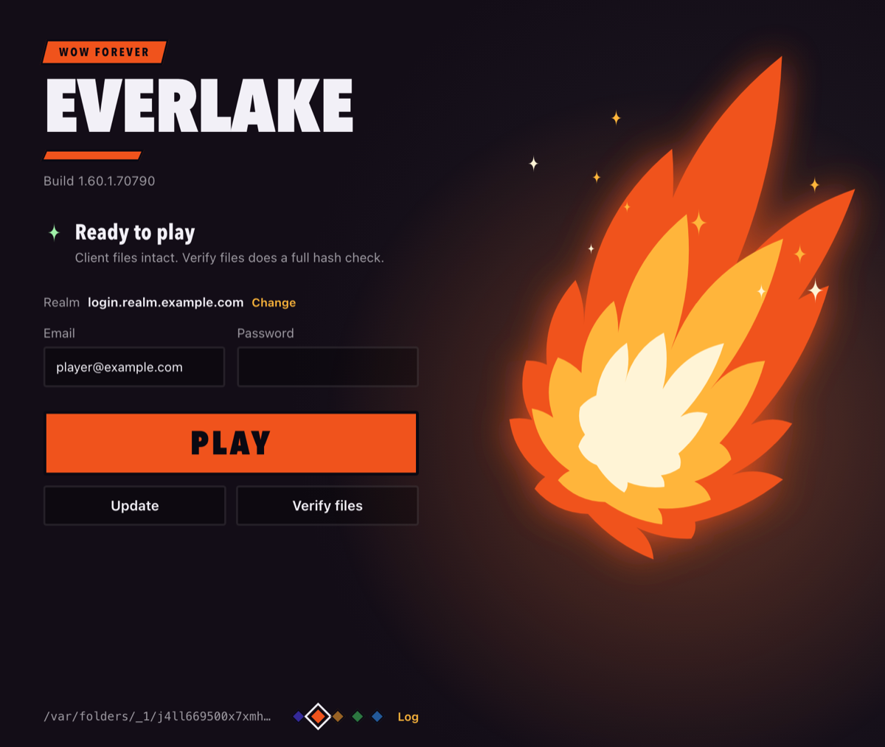

# Everlake launcher

The launcher for Project Everlake. It installs **one pinned build** of the WoW Forever client straight from
Blizzard's public CDN, checks every file against its hash, and repairs what's damaged. Later it also picks the
realm and starts the game.

It never follows Blizzard's live build: the build is pinned in [`internal/pin/wowf.json`](internal/pin/wowf.json)
and compiled in, so a launcher release always installs exactly the client the realm's server core supports.

## Starting it

**Double-click it.** The launcher opens as an app window with **Play**, **Install / update** and **Verify**, the
sign-in fields, and its output live. There's no console window and no browser tab. It installs to `C:\Everlake` on
Windows and `~/Everlake` on macOS until you pick another folder: **Change** next to the folder opens the system's
folder dialog (**Browse…**) or takes a typed path. A folder that already holds the game is used as it is (so you can
move an install and point the launcher at it); a folder with other things in it, or a drive root, gets an `Everlake`
folder inside it. Nothing is moved for you: after a change, Install downloads the game into the new folder. The
choice is saved in `launcher.json` in your config folder (`%AppData%\Everlake` on Windows, `~/Library/Application
Support/Everlake` on macOS); `ui --dir` starts on another folder without changing it.

**Animation on / off** in the footer stops the moving art (the spell burst, the progress stripes, the spinner).
Until you use it, the system's "reduce motion" setting decides. The colour swatches beside it pick the window's
colour. Both are kept in `launcher.json` too.



| | File | |
|---|---|---|
| Windows | `everlake-launcher-windows-amd64.exe` | Double-click. Not signed yet: SmartScreen → *More info → Run anyway*. |
| Windows | `everlake-launcher-cli-windows-amd64.exe` | The same program for typing commands in PowerShell (below). |
| macOS | `Everlake-Launcher-macos.dmg` (or `.zip`) | Drag *Everlake Launcher* to Applications, double-click. Not notarised: the first time, macOS refuses; open it anyway from *System Settings → Privacy & Security → Open Anyway*. |

The window shows the launcher's own page (the one `ui --browser` shows) in the system's web view: WebView2 on
Windows (part of Windows 11, and of Windows 10 through Windows Update), WKWebView on macOS. A PC without WebView2
gets the same page in its browser instead, and the launcher ends a couple of minutes after that page is closed.

Closing the window ends the launcher, except while a game it joined to a realm is running: it then keeps going in the
background, keeping the realm's key in the game, and ends when the game closes.

## Updating itself

The launcher keeps itself up to date. When its window opens, and every hour while it stays open, it asks GitHub
for this repository's **Latest** release (drafts and pre-releases never count). If that release's tag is a newer
version than its own, it updates itself, and the page shows it as a job (*Updating the launcher*, with a progress bar)
while the buttons wait:

1. It downloads its own file from that release (`everlake-launcher-windows-amd64.exe`,
   `everlake-launcher-cli-windows-amd64.exe` or `Everlake-Launcher-macos.zip`) into the folder it's in.
2. It checks the file against the release's `SHA256SUMS.txt` and refuses it if they differ. On macOS the unpacked
   app must also pass `codesign --verify`.
3. It runs the new copy with `version`, which must answer the release's tag. A copy that won't start (an antivirus
   took it, a broken build) or that names another version never goes in.
4. It moves itself aside (`<name>.old`; Windows lets a running program be renamed, not deleted) and puts the new
   copy in its place. The window's next start removes the `.old` copy.
5. The window closes and the new version opens in its place. If it doesn't start and the new copy has gone, the old
   one is put back.

It never updates while Install, Verify or Play is running or while a game it started is open. It waits until they
finish. It never goes back to an older version. A download that stalls for a minute is given up. A failed update is
tried at most three times per release until the launcher is next opened. If the folder it's in can't be written to,
or macOS is running it from a temporary copy (*App Translocation*: move the app to Applications first), the page says
so under the version line. `"auto_update": false` in `launcher.json` turns it off.

Updates are only as trustworthy as this repository's releases: the hashes come from the same release as the files, so
they catch a damaged download, not a release published by someone who shouldn't. Signing `SHA256SUMS.txt` with a key
built into the launcher would close that.

`update` does the same from a terminal (`update --check` only says whether there's a newer one); a launcher started
from a terminal (`ui --browser`, `--no-open`) doesn't update by itself. Only release builds
update: `scripts/package.sh` tells each build which release file it is. A `go build`, or a build whose version isn't a
release tag (`dev`, CI's `ci-1a2b3c4`), never replaces itself. Launchers older than this feature (v0.1.0-alpha.13 and
before) have no updater, so they have to be downloaded once by hand.

**Releasing** (the version must be the tag, since launchers compare the two):

```sh
scripts/package.sh windows v0.1.0-alpha.14
scripts/package.sh macos   v0.1.0-alpha.14     # on a Mac
scripts/package.sh sums
gh release create v0.1.0-alpha.14 --draft dist/*    # every file uploaded before anyone can see it
gh release edit   v0.1.0-alpha.14 --draft=false --latest   # a full release: pre-releases aren't offered as updates
```

Open launchers pick the update up within the hour (once idle), the rest when they next open. Without
`SHA256SUMS.txt` (or with a file missing from it) the release isn't installed.

## Status

Work in progress. What works today:

- `install` fetches the pinned build's configs, archive indexes, encoding file, install and download manifests, then
  the loose game files for your platform (the `.app` or `Wow.exe` and friends) and the data files, checking each
  one.
- The data files go into the game's own local storage, `Data/data` (`data.NNN` archives and `.idx` key tables, the
  layout a Battle.net install has), and `.build.info` names the build and the CDN. A folder an earlier launcher
  filled (with `.everlake/staged/`) is moved over without downloading again.
- `verify` re-checks what the install fetched (it reads `.everlake/install.json`), writes nothing, and lists what's
  damaged or missing; `install` again repairs exactly those. `verify --quick` is the fast check for every launch: it
  compares the client files (the loose files, configs, indexes, `.build.info`, `.flavor.info`) against the size and
  timestamp recorded at install, in a few milliseconds and without hashing. It doesn't deep-check the game's data
  storage (`Data/data`) — the full `verify` does that.
- A run that's stopped or killed resumes: the key tables are saved every 30 seconds, and a half-written archive
  with nothing pointing into it is removed.
- **Updating to a new pinned build** is the same `install`: it keeps every file whose key didn't change, fetches
  only the new ones, and once the new build is fully in place removes the old build's files and data (reclaiming the
  space). Nothing is removed until the update has succeeded. The game's own storage and anything it added are left
  alone. A trial install (`--no-data`, `--max-priority`, `--data-limit-mb`) never prunes data, so it can't delete
  what a fuller install fetched.
- **Joining a realm (Windows):** `play` signs in to the realm's login server and starts the game logged in, with the
  two in-memory changes the stock client needs to talk to it (see [Joining a realm](#joining-a-realm)). On macOS the
  game is hardened against this, so joining a realm stays with `wow-project-everlake`'s `everlake-client.sh`.

## Platforms

One binary per platform, no runtime to install:

- **Windows** (`GOOS=windows GOARCH=amd64`): installs into `<dir>\_forever_\Wow.exe`.
- **macOS** (`GOOS=darwin`, `arm64` and `amd64`): installs `<dir>/_forever_/World of Warcraft.app`, a proper
  universal `.app` with its executable bit set — the same folder a Battle.net install has, so
  `everlake-client.sh` can point at it instead of needing Battle.net.

`scripts/package.sh windows|macos [version]` builds the release files into `dist/`. The Windows exe is built with
`-H=windowsgui` (a GUI program: a double-click opens no console) and needs no cgo, so it builds anywhere. The Mac app
needs a Mac: its window uses Cocoa and WebKit through cgo, so it's built there for both architectures and joined into
one universal binary in `Everlake Launcher.app`. A Mac build made elsewhere (without cgo) works but shows the page in
the browser. CI builds both and keeps them as artifacts of each run.

Each Windows exe carries an icon, version information (name, publisher, version) and an application manifest, which
`scripts/winres` writes as a `.syso` just before the build; an exe without them is more likely to be taken for
malware by Windows Defender. The icon is drawn in `assets/icon.html` and rendered to `assets/icon-windows.png` and
`assets/icon-macos.png` (the Mac app's `AppIcon.icns` is made from the latter).

Pick the platform's files with `--tags` (default: this machine). The launcher installs any platform's client from
any platform, so a Mac can prepare a Windows folder and the other way round.

## Commands

Every command still works from a terminal. On Windows use `everlake-launcher-cli-windows-amd64.exe` for that: the
window build prints into the terminal too, but as a GUI program the terminal doesn't wait for it (the prompt comes
back straight away), and `play` can't ask for the password properly. On macOS the app's binary is
`"/Applications/Everlake Launcher.app/Contents/MacOS/everlake-launcher"`.

```sh
go build -o everlake-launcher ./cmd/everlake-launcher

./everlake-launcher show                                    # the pinned build: tags, file counts, sizes
./everlake-launcher install --dir ~/Everlake --no-data      # the game's loose files only (~400 MB)
./everlake-launcher install --dir ~/Everlake                # everything for this machine (~85 GB)
./everlake-launcher verify  --dir ~/Everlake                # full hash check
./everlake-launcher verify  --dir ~/Everlake --quick        # size + timestamps only, for every launch
./everlake-launcher pin                                     # what's live now, as a pin to review
./everlake-launcher start   --dir ~/Everlake                # starts the game the way Battle.net would (-uid wowf)
./everlake-launcher                                         # the window, for ~/Everlake (what a double-click does)
./everlake-launcher ui      --dir ~/Everlake                # the window, for another folder
./everlake-launcher ui      --dir ~/Everlake --browser      # the same page in the browser instead
./everlake-launcher update  [--check]                       # move to the newest release (the window does it itself)
everlake-launcher.exe play --dir C:\Everlake --login-host login.realm.example.com --email you@example.com
```

`ui` is the same jobs with buttons instead of typed commands: a page served only on your own machine (`127.0.0.1`)
showing whether the client is intact, with **Install / update**, **Verify** and **Play**, and the launcher's output
live, in the launcher's window (`--browser`: in your browser; `--no-open`: just served). On Windows the page also has
the sign-in fields: with a login server filled in, **Play** joins that realm like `play` does; left empty, it starts
the game on its own like `start`.

`--tags` picks platform, architecture, locale and region (default: this machine, `enUS`, `US`). The region matters:
the Mac game binary for CN differs from everyone else's. `--max-priority` and `--data-limit-mb` cut the data stage
short for trial runs. `--cdn host[:port],...` tries those hosts first and Blizzard's after them (our mirror,
below); a host may name its scheme (`http://` is the default, `https://` also works).

## Joining a realm

`play` (Windows) does what Battle.net does for Blizzard's realms, against a TrinityCore login server:

1. Signs in with your email and password (asked for; or `EVERLAKE_PASSWORD`; or the remembered one) over HTTPS on
   port 8081, and gets a
   login ticket and your game account. The login server needs a certificate your PC trusts (a real one, or pass
   `--ca` with the realm's own CA).
2. Leaves the ticket where the game reads it when started with `-launcherlogin`: `HKEY_CURRENT_USER\Software\Blizzard
   Entertainment\Battle.net\Launch Options\WoW` (`WEB_TOKEN`, encrypted for your Windows user; `GAME_ACCOUNT`;
   `CONNECTION_STRING`). Battle.net rewrites these whenever it starts WoW itself.
3. Writes `_forever_\WTF\Everlake.wtf` (your `Config.wtf` plus the login server) and starts
   `Wow.exe -uid wowf -launcherlogin -config Everlake.wtf`.
4. Changes two things in the running game's memory. It starts the game normally (never pauses it) and only writes
   where the game's memory is writable already. The files on disk are never touched.
   - **The login name.** The client only logs in at names ending in one of Blizzard's domains (a table in its data,
     `.actual.battle.net` first). The table entry is pointed at an empty string while you log in, so a realm can use a
     name of its own, and put back as soon as you're logged in; back at the login screen it's changed again. The
     ending itself, in the protection's read-only data, is never touched: the live client's protection
     (`Wow_loader.dll`) ends the game with a "Security Crash" about 30 seconds after start when it is, even with the
     bytes put back. Not needed, and not done, for a `*.actual.battle.net` login name.
   - **The server key.** The realm signs a message the client checks against 12 public keys it keeps in a table in
     memory, built when you log in. Entry 8 (the server's `Network.EnterEncryptedModeRegionGroup`) gets the realm's
     key: TrinityCore's stock key unless `--server-key` says otherwise. The client can rebuild that table, so the
     launcher keeps watching until the game closes: **leave the launcher running while you play** (closing its window
     is fine; it keeps running in the background).

The login server, email, key and CA are saved in `.everlake/realm.json` in the install folder; the password isn't.
**Remember password** (or `play --remember`) keeps it after a sign-in succeeds, encrypted with DPAPI for your Windows
user, in the launcher's own `launcher.json` (never in the install folder, never sent back to the page). With the
password field left empty, Play uses it; unticking the box forgets it on the next Play, and a password the login
server refuses is forgotten.
The key table follows jibay442/forever_docker and Karrz1/Karrz-playerbots-wow-forever's Windows launcher; the
login-name patch follows Arctium's launcher. On macOS, `wow-project-everlake`'s `client/macos/keypatch.c` patches
from inside the game.

## The mirror (our own CDN)

`mirror` runs on the server and answers like Blizzard's CDN, so a launcher on the same home network keeps installing
when Blizzard's CDN is down or slow (design and later steps: [docs/cdn-and-peers.md](docs/cdn-and-peers.md)). It is
for the local network only: it is never published to the internet. Players elsewhere download from Blizzard and,
later, from each other.

```sh
./everlake-launcher mirror --store /srv/cdn --prefetch               # serve on :8087, fetch the pinned build in the background
./everlake-launcher mirror --store /srv/cdn --plan-only              # how much the prefetch would fetch (88.3 GB for 70790)
./everlake-launcher install --dir ~/Everlake --cdn server:8087       # a launcher using it
```

- Every request is answered from `--overlay` (our own patched builds, served as they are), else the store, else
  Blizzard. What it gets from Blizzard is checked like an install checks it before it's kept or served, and what's in
  the store is checked again each time it's served, so a damaged copy is fetched again instead of handed out.
- Archives are kept by range (a sparse file plus a `.have` list of the ranges in it). The prefetch reads them in the
  launcher's own ranges, merged over Mac and Windows, so every range a launcher asks for is in the store.
- `--rate-mb` (default 40) caps the prefetch, `--memory-mb` (default 1024) the archive bytes held in memory at once.
  The mirror never forces writes to disk.
- The Everlake portal's compose file runs it as its `cdn` service (from this repo's `Dockerfile`).

## How it checks files

Every TACT file carries its own hash, and every parser here checks it:

| File | Check |
|---|---|
| build and CDN config | the name is the MD5 of the file |
| archive index | the name is the MD5 of its footer; the footer, table of contents and every block carry checksums |
| stored file (BLTE) | the encoded key is the MD5 of its header; the header lists an MD5 for every chunk |
| decoded file | the content key is the MD5 of the content (manifests, encoding file, loose game files) |
| encoding file | every page has an MD5 in the page index |
| local storage (`Data/data`) | each key table carries Jenkins checksums; each stored file is read back and checked as above |

So a file that parses is the file the pinned build names, byte for byte. Encrypted chunks are checked the same way
without being decrypted.

## Tests

```sh
go test ./...                                   # format parsers + a whole install against a fake CDN
                                                # (on Windows also: both game patches on a stand-in game process)
EVERLAKE_WINDOW_TEST=1 go test -run Window ./internal/appwindow   # Windows: opens a real WebView2 window
EVERLAKE_LIVE=1 go test -run Live ./internal/tact     # reads the real pinned build from Blizzard's CDN (~2 MB)
EVERLAKE_LIVE=full go test -run Live ./internal/tact  # also the encoding file (~135 MB)
```

## Licence

GPL-2.0, as the rest of Project Everlake.

## Optional Era map collection

Check **Era content** in the launcher and click **Download Era maps**. This
requires Python 3.9 or newer and curl. The launcher stages map assets in an
`_era_` subfolder of the folder selected in the launcher. Select a folder
on an external drive to keep both downloads on that drive. Existing Era
downloads in the previous user configuration location stay there. The download uses
pinned Classic Era, TBC Anniversary and Wrath Titan CDN builds and records a
catalog log and a per-map inventory. The Forever game directory and realm
settings are untouched. Cataclysm needs a verified CDN donor.

Run **Download Era maps** again to retry failed transfers. The launcher reuses
verified files and skips completed maps. See `_era_/logs/missing-files.tsv`
for the map, FileDataID, known asset path, and reason for each remaining gap.

### Shared Forever and Classic client

For a launcher deployment with a combined Forever and Classic build, set
`EVERLAKE_CLIENT_CDN` to the origin of the Everlake mirror serving the overlay.
The desktop installer reads `/everlake/build.json` from that origin and uses
the same mirror for the combined build's CDN objects. The mirror can fetch
unchanged objects from Blizzard. **Install** and **Update** use the selected
game folder and reuse intact objects already in its CASC store.

For local testing, place the built overlay (including `build.json` and
`tpr/`) under `_era_/overlay` in the install folder, or in `Classic-overlay`
beside the launcher executable. Leave `EVERLAKE_CLIENT_CDN` unset to use the
local package. Classic becomes available after the combined build is installed
on a supported platform.

### Separate Retail client and existing installations

Forever and the Classic–Wrath prototype use the Forever client. Retail needs a
separate `wow` installation with game folder `_retail_` and flavor `wow`.
The launcher includes the supported Retail pin; reviewed JSON overrides can be saved in Retail build configuration.
The optional `EVERLAKE_RETAIL_PIN` environment variable overrides the saved build. The desktop uses a sibling install folder
with `-Retail` appended to the selected Forever root. Retail Play uses the shared account form and its own realm settings.

```sh
everlake-launcher clients discover "/path/to/World of Warcraft"
everlake-launcher clients import --source "/path/to/World of Warcraft" --dir "/path/to/Everlake-Retail" --retail-pin "/path/to/retail.json"
everlake-launcher clients verify --dir "/path/to/Everlake-Retail" --retail-pin "/path/to/retail.json"
```

Close the game and Battle.net before importing. Use an unused destination with
an existing parent folder. Import accepts a single active build that matches the
selected pin, including both config keys. It copies the original build manifests,
local data, addons and WTF files. A Battle.net copy has no recorded Everlake
download coverage. The import verifies the copied bytes and keeps the original
intact. A Battle.net root containing several active products needs separate
validation before it can be imported.

Rerun the same import command after interruption to resume from the journal in
`NEW_ROOT.everlake-import`. If the source changes, use a new destination. After
publication the original still serves as recovery, and the staging directory
holds the journal. Select the original installation to revert to it. Keep the
original until you've verified and played the managed copy.

Allow enough free space for an independent copy. The migration does not share
writable CASC containers, addon folders or SavedVariables between products.
Retail streaming downloads assets to disk as needed.

The desktop's Import an existing client section inspects a source folder and
reports its regular-file count and byte size before copying. It accepts the
same source and destination on a retry. Retail imports save their destination
as the Retail install path. After a Forever import, select its destination
using Change. Retail's saved build configuration persists across app restarts.

Retail defaults to 12.1.5.70783, supported by TrinityCore master commit
4d146b59c47d60007ffc5fca89d45339814b6dba (the 2026-11-04 auth update).
The compiled pin includes Blizzard's build and CDN config keys.
Retail configuration is an optional override.

Use Install Retail for streaming to download loose client files and
priority-zero assets first. Further assets download to disk during play.
Download full Retail client fetches the remaining manifest content.
The CLI equivalents are `clients install --retail --streaming --dir ROOT`
and `clients install --retail --dir ROOT`. Verification and launch accept
`--retail` as well. `show --retail` reports the pinned download manifests.

### Account login and shared assets

Forever and Retail use the same account form and remember the last successful
login host and email. Realm ports, server keys and client settings remain in
each client installation. Windows uses the existing DPAPI ticket handoff.
macOS uses the project's existing ticket encryption and patch helper, creating
a temporary signed app copy for each realm launch. Release apps include the universal patch helper. Source-only development builds
need Apple's command-line tools to compile it. The official downloaded app is retained.

Verified encoded objects are cached in `.everlake-assets` beside the client folder
on the same drive (`EVERLAKE_ASSET_STORE` overrides this location). Each object is checked against its encoded key before reuse.
Different encoded variants have distinct keys. This can reduce repeat downloads.
On filesystems supporting macOS copy-on-write cloning, complete byte-identical
CASC archives also share disk blocks through independent files. Client indexes,
manifests and writable paths remain independent. Unsupported filesystems retain
ordinary client archives. The cache itself uses disk space, and logical byte
counts do not establish physical savings.

The launcher never deduplicates addons or SavedVariables across client products.

### Reusing an older client on a slow connection

Choose **Install using existing files**, enter the existing World of Warcraft
root (the folder containing `.build.info` and `Data`), and a separate destination.
The source can be an older build or a multi-product Battle.net installation.
Keep the game and Battle.net closed during the operation. The source is read-only.

The target manifest decides what is reusable: encoded keys and BLTE chunk
checksums are checked for stored assets, and content hashes for loose files.
Missing, changed, or damaged content downloads from the CDN. Older executables
are never used merely because their names match. Configuration, addon settings,
and account files are not copied by this reuse operation; exact-build import
remains available when a complete migration is wanted. The destination requires
space for an independent client; rerun with the same folders to resume.

```powershell
.\everlake-launcher-cli-windows-amd64.exe clients install --retail --source "D:\Games\World of Warcraft" --dir "D:\Everlake\Retail"
```

Add `--streaming` for launch assets first. Matching assets already on disk save
bandwidth; metadata and genuinely missing target-build assets still need internet.

### Low-space in-place updates

Use **Update existing installation in place** to take over an existing single-product
client root. On the CLI, use `clients install --retail --in-place --dir ROOT`
(add `--streaming` for launch assets first). This updates that folder directly,
verifies existing assets, and downloads replacements without creating a second
client or an object-cache copy. The low-space choice persists for later updates.
Close Battle.net and the game first. Multi-product Battle.net roots are rejected
because their data may be shared with another installed product.

Addons and WTF/SavedVariables are preserved. The original build metadata is
backed up, but there is no complete old-build rollback copy. Space for changed
assets is checked; a full successful update can remove unreferenced adopted
archives. Mixed archives remain while they still contain good referenced assets.

### Saved login and game accessibility

The Mac launcher offers **Remember me**. Passwords stay in macOS Keychain;
launcher settings contain only opaque references. Windows retains DPAPI.
Unchecking Remember me on a successful login forgets the stored credential.
The private Everlake game config explicitly disables screen narration and its
onboarding prompt on launch; the original Config.wtf is not changed.
